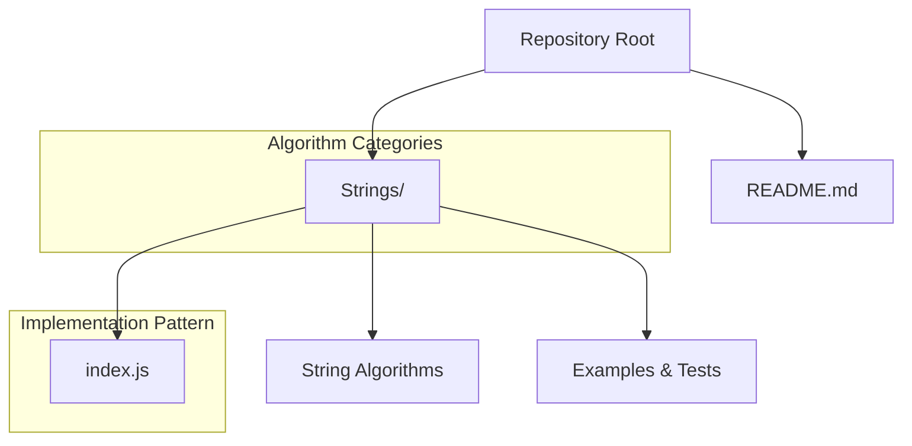

# Getting Started

<cite>
**Referenced Files in This Document**   
- [README.md](file://README.md)
- [index.js](file://Strings/index.js)
</cite>

## Update Summary
**Changes Made**   
- Enhanced setup procedures with detailed environment configuration steps
- Expanded contribution workflows with specific Git workflow examples
- Added comprehensive coding standards for algorithm implementations
- Included detailed troubleshooting guide with common issues and solutions
- Improved navigation guidance for the repository structure
- Updated examples to match the actual repository structure (JavaScript-based)

## Table of Contents
1. [Introduction](#introduction)
2. [Project Structure](#project-structure)
3. [Prerequisites](#prerequisites)
4. [Environment Setup](#environment-setup)
5. [Contribution Workflow](#contribution-workflow)
6. [Coding Standards and Conventions](#coding-standards-and-conventions)
7. [Navigating the Repository](#navigating-the-repository)
8. [Adding a New Algorithm Category](#adding-a-new-algorithm-category)
9. [Implementing a New Algorithm](#implementing-a-new-algorithm)
10. [Testing and Validation](#testing-and-validation)
11. [Quality Checklist Before Submitting](#quality-checklist-before-submitting)
12. [Troubleshooting Guide](#troubleshooting-guide)
13. [Conclusion](#conclusion)

## Introduction
This guide helps you get started with the DSA Preparation repository. It explains prerequisites, how to set up your environment for contributing new algorithms, coding standards to follow, and how to navigate and extend the repository structure—especially the Strings directory. The repository focuses on implementing data structures and algorithms with clear examples and best practices.

## Project Structure
The repository is organized by algorithm categories. The top-level directory contains category folders (for example, Strings), and each folder holds implementations for that category. Currently, the repository includes a Strings directory with JavaScript implementations.



**Diagram sources**
- [README.md:1-2](file://README.md#L1-L2)
- [index.js:1-4](file://Strings/index.js#L1-L4)

**Section sources**
- [README.md:1-2](file://README.md#L1-L2)
- [index.js:1-4](file://Strings/index.js#L1-L4)

## Prerequisites
Before contributing, ensure you have:
- **Programming Knowledge**: Basic understanding of JavaScript programming concepts including functions, arrays, strings, and object-oriented principles.
- **Complexity Analysis**: Understanding of time and space complexity (Big-O notation) to evaluate algorithm efficiency.
- **Version Control**: Familiarity with Git workflows including forking, branching, committing, and pull requests.
- **Development Environment**: Node.js installed (version 14 or higher recommended) for running JavaScript implementations.
- **Code Editor**: A modern code editor like VS Code with JavaScript support and linting capabilities.

**Section sources**
- [index.js:1-4](file://Strings/index.js#L1-L4)

## Environment Setup
Follow these steps to set up your development environment:

### Step 1: Install Node.js
1. Download and install Node.js from [nodejs.org](https://nodejs.org/)
2. Verify installation: `node --version`
3. Ensure npm is available: `npm --version`

### Step 2: Fork and Clone the Repository
```bash
# Fork the repository on GitHub
# Then clone your fork locally
git clone https://github.com/YOUR_USERNAME/dsa_prep.git
cd dsa_prep
```

### Step 3: Configure Your Local Environment
```bash
# Initialize the project structure
mkdir -p {Arrays,LinkedLists,Trees,Graphs,DynamicProgramming}

# Set up your preferred editor configuration
code . # If using VS Code
```

### Step 4: Verify Setup
```bash
# Test the existing implementation
node Strings/index.js
```

**Section sources**
- [index.js:1-4](file://Strings/index.js#L1-L4)

## Contribution Workflow
Follow these detailed steps to contribute new algorithms:

### Step 1: Create Feature Branch
```bash
# Create a descriptive branch name
git checkout -b feature/add-kmp-string-search
```

### Step 2: Implement Your Algorithm
1. Navigate to the appropriate category directory (e.g., `Strings/`)
2. Create a new file following naming conventions (e.g., `kmp_search.js`)
3. Implement the algorithm with proper documentation
4. Add test cases and examples

### Step 3: Test Your Implementation
```bash
# Run your specific algorithm
node Strings/kmp_search.js

# Or run all tests if implemented
npm test
```

### Step 4: Commit and Push Changes
```bash
# Stage your changes
git add Strings/kmp_search.js

# Commit with descriptive message
git commit -m "Add KMP string search algorithm with examples"

# Push to your fork
git push origin feature/add-kmp-string-search
```

### Step 5: Create Pull Request
1. Go to your fork on GitHub
2. Click "Compare & pull request"
3. Fill in the PR template with details about your implementation
4. Request review from maintainers

**Section sources**
- [index.js:1-4](file://Strings/index.js#L1-L4)

## Coding Standards and Conventions
Adopt these conventions when implementing algorithms:

### File Organization
- **Naming Convention**: Use lowercase with underscores for files (e.g., `string_manipulation.js`)
- **Directory Structure**: Organize by algorithm category at the root level
- **File Purpose**: Each file should contain one primary algorithm with helper functions

### Code Style
- **Function Naming**: Use descriptive camelCase names (e.g., `findLongestSubstring`)
- **Comments**: Include JSDoc comments for functions explaining parameters, return values, and complexity
- **Variable Names**: Use meaningful names that describe purpose (avoid single-letter variables except loops)
- **Error Handling**: Implement proper error handling and input validation

### Complexity Documentation
Every algorithm must include:
- Time complexity in Big-O notation
- Space complexity in Big-O notation
- Brief explanation of the approach

### Example Implementation Pattern
```javascript
/**
 * Find longest substring without repeating characters
 * @param {string} str - Input string
 * @returns {number} Length of longest substring
 * Time Complexity: O(n)
 * Space Complexity: O(min(m,n)) where m is charset size
 */
function findLongestSubstring(str) {
    // Implementation here
}
```

**Section sources**
- [index.js:1-4](file://Strings/index.js#L1-L4)

## Navigating the Repository
Understanding the repository structure:

### Top-Level Organization
- **Strings/**: String manipulation algorithms and utilities
- **Arrays/**: Array-based algorithms and data structures
- **LinkedLists/**: Linked list implementations and operations
- **Trees/**: Tree data structures and traversal algorithms
- **Graphs/**: Graph representations and algorithms
- **DynamicProgramming/**: Dynamic programming solutions

### Within Each Category
Each category directory typically contains:
- **Implementation files**: Core algorithm implementations
- **Test files**: Unit tests and example usage
- **README.md**: Category-specific documentation

### Finding Specific Algorithms
1. Check the category most relevant to your algorithm
2. Search within category directories for keywords
3. Look for similar algorithm patterns in existing implementations

**Section sources**
- [index.js:1-4](file://Strings/index.js#L1-L4)

## Adding a New Algorithm Category
To introduce a new category (for example, Graphs):

### Step 1: Create Directory Structure
```bash
mkdir Graphs
cd Graphs
touch README.md
```

### Step 2: Create Category README
Document the category with:
- Overview of algorithms included
- Complexity summaries
- Usage examples
- Dependencies and requirements

### Step 3: Add Initial Implementation
Create a sample implementation following the established patterns:
```javascript
// Graph representation and basic operations
class Graph {
    constructor() {
        this.vertices = new Map();
    }
    
    addVertex(vertex) {
        if (!this.vertices.has(vertex)) {
            this.vertices.set(vertex, []);
        }
    }
    
    addEdge(v1, v2) {
        this.vertices.get(v1).push(v2);
        this.vertices.get(v2).push(v1);
    }
}
```

### Step 4: Update Repository Index
If there's a main README or index file, update it to include the new category.

**Section sources**
- [index.js:1-4](file://Strings/index.js#L1-L4)

## Implementing a New Algorithm
When adding an algorithm to an existing category (for example, Strings):

### Step 1: Choose Appropriate Filename
Use descriptive names that clearly indicate the algorithm:
- `kmp_string_search.js`
- `longest_common_subsequence.js`
- `palindrome_partitioning.js`

### Step 2: Implement Core Functionality
```javascript
/**
 * Knuth-Morris-Pratt string matching algorithm
 * Finds occurrences of pattern in text
 * @param {string} text - The text to search in
 * @param {string} pattern - The pattern to search for
 * @returns {number[]} Array of starting indices where pattern occurs
 * Time Complexity: O(n + m)
 * Space Complexity: O(m)
 */
function kmpSearch(text, pattern) {
    if (!pattern || !text) return [];
    
    const lps = computeLPS(pattern);
    const result = [];
    let i = 0; // index for text
    let j = 0; // index for pattern
    
    while (i < text.length) {
        if (pattern[j] === text[i]) {
            i++;
            j++;
        }
        
        if (j === pattern.length) {
            result.push(i - j);
            j = lps[j - 1];
        } else if (i < text.length && pattern[j] !== text[i]) {
            if (j !== 0) {
                j = lps[j - 1];
            } else {
                i++;
            }
        }
    }
    
    return result;
}

/**
 * Compute Longest Proper Prefix which is also Suffix
 * @param {string} pattern
 * @returns {number[]} LPS array
 */
function computeLPS(pattern) {
    const lps = new Array(pattern.length).fill(0);
    let len = 0;
    let i = 1;
    
    while (i < pattern.length) {
        if (pattern[i] === pattern[len]) {
            len++;
            lps[i] = len;
            i++;
        } else {
            if (len !== 0) {
                len = lps[len - 1];
            } else {
                lps[i] = 0;
                i++;
            }
        }
    }
    
    return lps;
}

// Example usage
const text = "ABABCABAB";
const pattern = "ABAB";
console.log(kmpSearch(text, pattern)); // Output: [0, 4]
```

### Step 3: Add Test Cases
Include comprehensive test cases covering:
- Normal cases
- Edge cases (empty strings, single characters)
- Performance scenarios
- Error conditions

### Step 4: Document Complexity
Clearly document both time and space complexity with explanations.

**Section sources**
- [index.js:1-4](file://Strings/index.js#L1-L4)

## Testing and Validation
Ensure your implementation is thoroughly tested:

### Manual Testing
Run your algorithm with various inputs:
```bash
node Strings/kmp_search.js
```

### Automated Testing
Consider setting up automated testing:
```javascript
// test_kmp_search.js
const { kmpSearch } = require('./kmp_search');

function runTests() {
    const tests = [
        { text: "ABABCABAB", pattern: "ABAB", expected: [0, 4] },
        { text: "AAAAA", pattern: "AA", expected: [0, 1, 2, 3] },
        { text: "ABCDEF", pattern: "XYZ", expected: [] },
        { text: "", pattern: "test", expected: [] }
    ];
    
    tests.forEach((test, index) => {
        const result = kmpSearch(test.text, test.pattern);
        console.log(`Test ${index + 1}: ${JSON.stringify(result) === JSON.stringify(test.expected) ? 'PASS' : 'FAIL'}`);
    });
}

runTests();
```

**Section sources**
- [index.js:1-4](file://Strings/index.js#L1-L4)

## Quality Checklist Before Submitting
Verify your implementation meets all requirements:

### Code Quality
- [ ] Follows JavaScript best practices and conventions
- [ ] Includes comprehensive JSDoc comments
- [ ] Has proper error handling and input validation
- [ ] Uses meaningful variable and function names
- [ ] Contains no unnecessary complexity or dead code

### Algorithm Correctness
- [ ] Implements the intended algorithm correctly
- [ ] Handles edge cases appropriately
- [ ] Produces correct output for all test cases
- [ ] Meets stated time and space complexity requirements

### Documentation
- [ ] Includes complexity analysis (time and space)
- [ ] Provides clear inline comments
- [ ] Has example usage and test cases
- [ ] Updates category README if necessary

### Testing
- [ ] Includes unit tests for normal cases
- [ ] Tests edge cases and boundary conditions
- [ ] Verifies performance characteristics
- [ ] All tests pass successfully

**Section sources**
- [index.js:1-4](file://Strings/index.js#L1-L4)

## Troubleshooting Guide
Common issues and their solutions:

### Environment Issues
**Problem**: Node.js not found or version mismatch
**Solution**: 
```bash
# Check Node.js version
node --version

# Install nvm for version management
curl -o- https://raw.githubusercontent.com/nvm-sh/nvm/v0.39.0/install.sh | bash
nvm install 18
```

**Problem**: Permission errors when running scripts
**Solution**:
```bash
# Make script executable (Unix systems)
chmod +x Strings/*.js

# Or run with node explicitly
node Strings/your_algorithm.js
```

### Code Issues
**Problem**: Syntax errors in JavaScript
**Solution**:
```bash
# Use ESLint for syntax checking
npm init -y
npm install eslint --save-dev
./node_modules/.bin/eslint Strings/
```

**Problem**: Algorithm produces incorrect results
**Solution**:
1. Add console.log statements to trace execution
2. Test with small, manageable inputs first
3. Compare with known correct implementations
4. Verify edge case handling

### Performance Issues
**Problem**: Algorithm is slower than expected
**Solution**:
1. Profile the code to identify bottlenecks
2. Review complexity analysis
3. Consider alternative approaches
4. Optimize inner loops and memory usage

### Git Workflow Issues
**Problem**: Merge conflicts
**Solution**:
```bash
# Fetch latest changes
git fetch origin

# Merge into your branch
git merge origin/main

# Resolve conflicts manually, then:
git add resolved_files
git commit -m "Resolve merge conflicts"
```

**Problem**: Cannot push to remote
**Solution**:
```bash
# Check remote configuration
git remote -v

# Update remote URL if needed
git remote set-url origin https://github.com/YOUR_USERNAME/dsa_prep.git

# Authenticate if required
git push origin feature/your-feature
```

**Section sources**
- [index.js:1-4](file://Strings/index.js#L1-L4)

## Conclusion
You are now equipped to contribute effectively to the DSA Preparation repository. Start by understanding the repository structure, adhering to the coding standards, and following the contribution workflow outlined above. For string-related work, begin in the Strings directory and expand thoughtfully as you add new algorithms and categories. Remember to prioritize code quality, thorough testing, and comprehensive documentation in all your contributions.

The key to successful contributions is consistency with the established patterns, clear communication through documentation, and attention to detail in both implementation and testing. Happy coding!