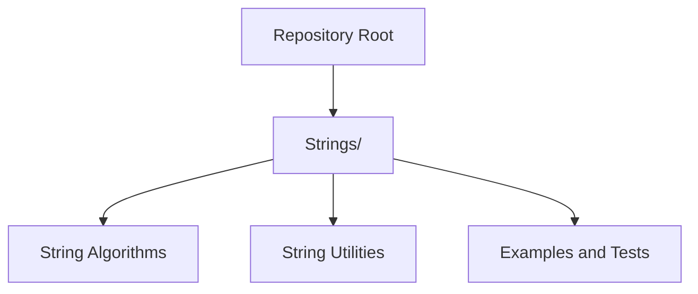

# Getting Started

<cite>
**Referenced Files in This Document**   
- [README.md](file://README.md)
</cite>

## Table of Contents
1. [Introduction](#introduction)
2. [Project Structure](#project-structure)
3. [Prerequisites](#prerequisites)
4. [Setup and Contribution Workflow](#setup-and-contribution-workflow)
5. [Coding Standards and Conventions](#coding-standards-and-conventions)
6. [Navigating the Repository](#navigating-the-repository)
7. [Adding a New Algorithm Category](#adding-a-new-algorithm-category)
8. [Implementing a New Algorithm](#implementing-a-new-algorithm)
9. [Quality Checklist Before Submitting](#quality-checklist-before-submitting)
10. [Troubleshooting Guide](#troubleshooting-guide)
11. [Conclusion](#conclusion)

## Introduction
This guide helps you get started with the DSA Preparation repository. It explains prerequisites, how to set up your environment for contributing new algorithms, coding standards to follow, and how to navigate and extend the repository structure—especially the Strings directory.

## Project Structure
The repository is organized by algorithm categories. The top-level directory contains category folders (for example, Strings), and each folder holds implementations for that category.

[No sources needed since this diagram shows conceptual structure]

## Prerequisites
Before contributing, ensure you have:
- Basic programming knowledge in the language used by the repository.
- Understanding of time and space complexity (Big-O notation).
- Familiarity with version control workflows (forking, branching, pull requests).
- A local development environment configured for the chosen language.

[No sources needed since this section provides general guidance]

## Setup and Contribution Workflow
Follow these steps to contribute new algorithms:
1. Fork the repository to your account.
2. Clone your fork locally.
3. Create a feature branch named after the algorithm or category (for example, feature/add-kmp-string-search).
4. Implement your solution following the coding standards below.
5. Add tests or examples if applicable.
6. Commit changes with clear messages.
7. Push your branch and open a pull request.
8. Address review feedback and finalize the PR.

[No sources needed since this section provides general guidance]

## Coding Standards and Conventions
Adopt these conventions when implementing algorithms:
- Naming: Use descriptive names for functions, classes, and files. Avoid abbreviations unless they are widely understood.
- Complexity: Include comments describing time and space complexity for non-trivial solutions.
- Modularity: Keep functions focused on a single responsibility; extract helpers where appropriate.
- Readability: Prefer clarity over cleverness; add concise comments explaining key steps.
- Testing: Provide unit tests or example inputs/outputs demonstrating correctness.
- Documentation: Add brief inline documentation for public interfaces.
- Consistency: Follow existing patterns in the repository for file organization and naming.

[No sources needed since this section provides general guidance]

## Navigating the Repository
- Top-level directories represent algorithm categories.
- Each category directory contains implementations and related materials.
- The Strings directory is dedicated to string-related algorithms and utilities.
- When looking for a specific algorithm, search within its category directory first.

[No sources needed since this section provides general guidance]

## Adding a New Algorithm Category
To introduce a new category (for example, Graphs):
1. Create a new top-level directory named after the category (for example, Graphs/).
2. Organize files inside the directory using consistent naming (for example, by algorithm name).
3. Add a README or index file at the category level to describe included algorithms and their complexities.
4. Update any top-level navigation or index if present.
5. Ensure your implementation follows the coding standards.

[No sources needed since this section provides general guidance]

## Implementing a New Algorithm
When adding an algorithm to an existing category (for example, Strings):
1. Choose a clear filename reflecting the algorithm (for example, kmp_search.py).
2. Implement the core function(s) with well-defined inputs and outputs.
3. Add complexity annotations in comments.
4. Provide test cases or example usage demonstrating typical and edge scenarios.
5. If the algorithm requires helper functions, place them in the same file or a clearly named utility module within the category.
6. Review your code against the coding standards before submitting.

[No sources needed since this section provides general guidance]

## Quality Checklist Before Submitting
- Does the implementation match the intended algorithm?
- Are time and space complexities documented?
- Are there tests or examples covering normal and edge cases?
- Is the code readable and well-named?
- Does it follow the repository’s conventions?
- Have you updated relevant documentation or indexes?

[No sources needed since this section provides general guidance]

## Troubleshooting Guide
Common issues and resolutions:
- Missing dependencies: Install required packages as specified by the project’s language setup.
- Test failures: Verify input/output formats and boundary conditions; add failing tests to reproduce issues.
- Performance regressions: Revisit complexity claims; optimize hot paths and avoid unnecessary allocations.
- Style inconsistencies: Run linters/formatters if available; align with existing naming and structure.

[No sources needed since this section provides general guidance]

## Conclusion
You are now ready to contribute to the DSA Preparation repository. Start by understanding the structure, adhering to the coding standards, and following the contribution workflow. For string-related work, begin in the Strings directory and expand thoughtfully as you add new algorithms and categories.