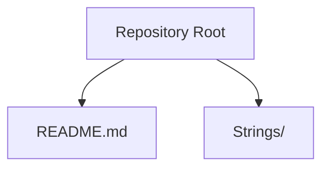
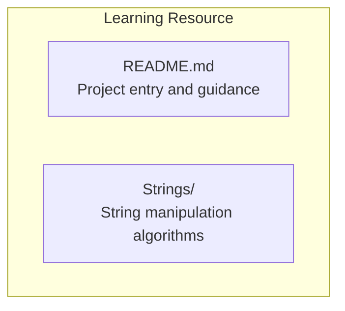
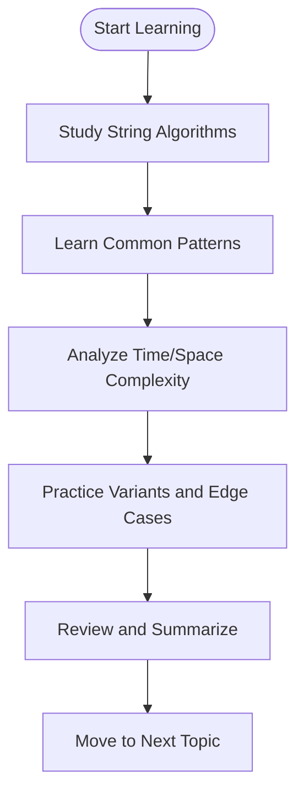
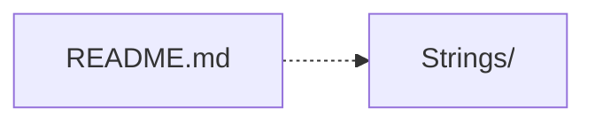

# Project Overview

<cite>
**Referenced Files in This Document**   
- [README.md](file://README.md)
</cite>

## Table of Contents
1. [Introduction](#introduction)
2. [Project Structure](#project-structure)
3. [Core Components](#core-components)
4. [Architecture Overview](#architecture-overview)
5. [Detailed Component Analysis](#detailed-component-analysis)
6. [Dependency Analysis](#dependency-analysis)
7. [Performance Considerations](#performance-considerations)
8. [Troubleshooting Guide](#troubleshooting-guide)
9. [Conclusion](#conclusion)
10. [Appendices](#appendices)

## Introduction
This repository is a learning resource for Data Structures and Algorithms (DSA). Its purpose is to provide a focused, organized collection of algorithmic implementations and examples that help learners build strong problem-solving skills. The project emphasizes clarity, correctness, and progressive difficulty so that users can steadily improve their understanding of core concepts such as time/space complexity, data organization, and algorithm design patterns.

Educational goals:
- Build intuition for common DSA patterns and techniques
- Practice implementing algorithms from scratch with clean structure
- Develop the ability to analyze complexity and trade-offs
- Prepare effectively for technical interviews and coursework

Target audience:
- Students studying computer science or related fields
- Interview candidates preparing for coding assessments
- Developers seeking to strengthen algorithmic thinking and problem-solving habits

## Project Structure
The repository follows a simple, feature-based layout centered around topic directories. At present, it includes:
- Strings: A directory dedicated to string manipulation algorithms and problems.

**Diagram sources**
- [README.md:1-2](file://README.md#L1-L2)

How to navigate and use this collection:
- Start by reviewing the README to understand the project’s scope and how to contribute or extend it.
- Explore the Strings directory to find string-related algorithms and problems. As more topics are added, follow the same pattern: open the relevant directory and review the files inside.
- Treat each file as a self-contained example or implementation. When available, read comments and any included notes to understand the approach and complexity.

**Section sources**
- [README.md:1-2](file://README.md#L1-L2)

## Core Components
At this stage, the repository provides a minimal but extensible foundation:
- README.md: Serves as the entry point and documentation hub for the project.
- Strings/: Intended home for string manipulation algorithms and exercises.

As the repository grows, you can expect additional topic directories (for example, arrays, linked lists, trees, graphs, dynamic programming) following the same organizational model.

**Section sources**
- [README.md:1-2](file://README.md#L1-L2)

## Architecture Overview
Conceptually, this repository is a curated set of standalone algorithm modules grouped by topic. Each module focuses on a specific area (e.g., strings), enabling learners to study one concept at a time without cross-topic distractions.

[No sources needed since this diagram shows conceptual workflow, not actual code structure]

## Detailed Component Analysis
### Strings Directory
Purpose:
- Hosts string manipulation algorithms and practice problems.
- Encourages incremental mastery of string processing techniques such as two-pointer methods, sliding windows, hashing, and transformations.

How to use it effectively:
- Identify the specific string technique you want to learn or practice.
- Open the corresponding file(s) under Strings and study the implementation approach.
- Reproduce the solution independently, then modify inputs to test edge cases.
- Reflect on time and space complexity and consider alternative approaches.

When expanding the repository:
- Add new topic directories (e.g., Arrays/, Trees/) using the same naming convention.
- Keep each file focused on a single algorithm or problem type.
- Include brief comments explaining the idea, constraints, and complexity.

**Section sources**
- [README.md:1-2](file://README.md#L1-L2)

### Conceptual Overview
A typical learning pathway using this repository:
- Begin with foundational topics (strings, arrays, basic data structures).
- Progress to intermediate patterns (sliding window, two pointers, hash maps).
- Advance to complex structures and algorithms (trees, graphs, dynamic programming).
- Reinforce learning through repeated practice and reflection on complexity.

[No sources needed since this diagram shows conceptual workflow, not actual code structure]

## Dependency Analysis
Currently, there are no programmatic dependencies between components. The repository is structured as independent files grouped by topic, which keeps coupling low and makes it easy to add new areas without affecting existing ones.

**Diagram sources**
- [README.md:1-2](file://README.md#L1-L2)

**Section sources**
- [README.md:1-2](file://README.md#L1-L2)

## Performance Considerations
- Focus on understanding the trade-offs between different approaches (e.g., brute force vs. optimized solutions).
- Always estimate and justify time and space complexity for each algorithm.
- Prefer clear, readable implementations first; optimize only after correctness and clarity are established.
- Use small test cases to validate behavior before scaling up.

[No sources needed since this section provides general guidance]

## Troubleshooting Guide
- If a file seems incomplete, check whether it is still being developed or if it needs additional comments and tests.
- When an algorithm does not match expected results, verify input constraints and edge cases (empty inputs, duplicates, large values).
- For performance issues, revisit the complexity analysis and consider alternative strategies (hashing, two pointers, divide and conquer).

[No sources needed since this section provides general guidance]

## Conclusion
This repository offers a focused starting point for mastering Data Structures and Algorithms, with an initial emphasis on string manipulation. By following the topic-based structure and practicing consistently, learners can build a solid foundation for advanced topics and interview preparation. As the collection expands, it will continue to serve as a practical, modular resource for developers and students aiming to strengthen their algorithmic thinking.

[No sources needed since this section summarizes without analyzing specific files]

## Appendices
- How to contribute:
  - Add new topic directories following the existing naming conventions.
  - Keep each file focused and well-commented.
  - Include complexity notes and sample usage where helpful.

[No sources needed since this section provides general guidance]