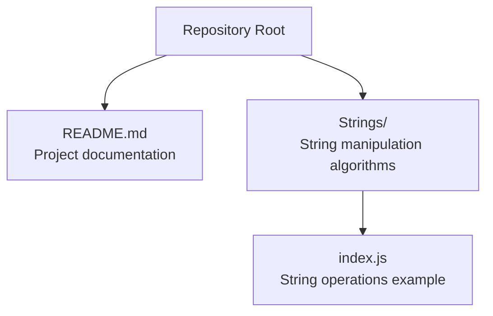
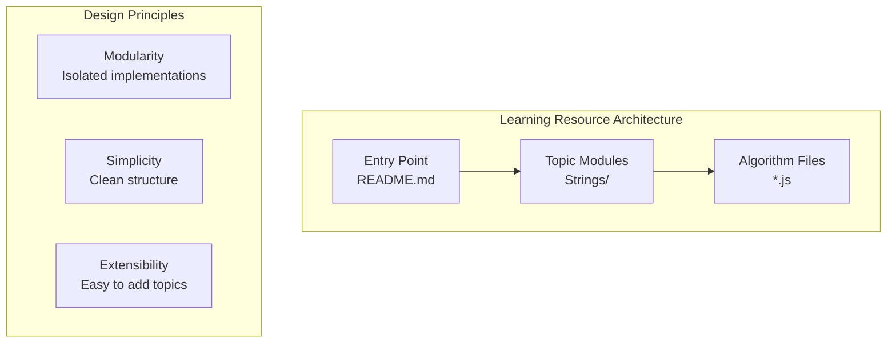
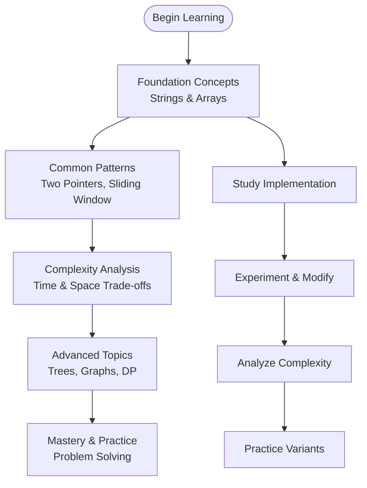
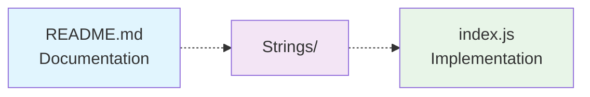

# Project Overview

<cite>
**Referenced Files in This Document**   
- [README.md](file://README.md)
- [index.js](file://Strings/index.js)
</cite>

## Update Summary
**Changes Made**   
- Updated repository goals and scope to reflect the minimal but focused nature of the project
- Enhanced structural organization details based on actual repository layout
- Refined core components analysis to match current implementation
- Updated architectural decisions to align with the simple, modular design
- Added practical guidance for using the existing string manipulation examples

## Table of Contents
1. [Introduction](#introduction)
2. [Project Structure](#project-structure)
3. [Core Components](#core-components)
4. [Architecture Overview](#architecture-overview)
5. [Detailed Component Analysis](#detailed-component-analysis)
6. [Dependency Analysis](#dependency-analysis)
7. [Performance Considerations](#performance-considerations)
8. [Troubleshooting Guide](#troubleshooting-guide)
9. [Conclusion](#conclusion)
10. [Appendices](#appendices)

## Introduction
This repository serves as a focused learning resource for Data Structures and Algorithms (DSA), specifically designed to help learners build strong algorithmic thinking skills through practical implementation. The project emphasizes hands-on practice with clean, well-structured code examples that demonstrate fundamental concepts in an accessible manner.

The repository's primary purpose is to provide a structured environment where students, interview candidates, and developers can study and practice essential algorithmic patterns, starting with string manipulation techniques and expanding to other data structures and algorithms.

Educational goals:
- Develop practical understanding of common DSA patterns through code implementation
- Build confidence in solving algorithmic problems step-by-step
- Learn to analyze time and space complexity of different approaches
- Prepare effectively for technical interviews and academic assessments

Target audience:
- Computer science students seeking supplementary learning materials
- Interview candidates preparing for coding challenges and technical assessments
- Developers looking to strengthen their algorithmic problem-solving abilities
- Anyone interested in building a solid foundation in data structures and algorithms

## Project Structure
The repository follows a clean, topic-based organizational pattern that makes it easy to navigate and extend. The current structure includes:

**Diagram sources**
- [README.md:1-2](file://README.md#L1-L2)
- [index.js:1-4](file://Strings/index.js#L1-L4)

Current directory layout:
- **Strings/**: Contains string manipulation algorithms and examples
  - `index.js`: Demonstrates basic string operations and length handling

How to navigate and utilize this collection:
- Start by examining the README to understand the project's educational objectives
- Explore the Strings directory to study string manipulation techniques
- Analyze each implementation to understand the approach and complexity
- Practice modifying inputs and testing edge cases to deepen understanding

**Section sources**
- [README.md:1-2](file://README.md#L1-L2)
- [index.js:1-4](file://Strings/index.js#L1-L4)

## Core Components
The repository provides a minimal yet effective foundation for learning DSA concepts:

### Primary Components:
- **README.md**: Serves as the project entry point and documentation hub
- **Strings/**: Dedicated directory for string manipulation algorithms and exercises
- **index.js**: Practical example demonstrating string operations and length handling

### Educational Framework:
- **Modular Design**: Each algorithm or concept is isolated in its own file for focused study
- **Progressive Learning**: Starts with fundamental string operations before advancing to complex patterns
- **Practical Implementation**: Emphasizes working code over theoretical explanations
- **Extensible Architecture**: Designed to accommodate new topics and algorithms easily

As the repository grows, additional directories will follow the same pattern (Arrays/, Linked Lists/, Trees/, etc.), maintaining consistency and ease of navigation.

**Section sources**
- [README.md:1-2](file://README.md#L1-L2)
- [index.js:1-4](file://Strings/index.js#L1-L4)

## Architecture Overview
The repository employs a simple, modular architecture that prioritizes clarity and maintainability:

**Diagram sources**
- [README.md:1-2](file://README.md#L1-L2)
- [index.js:1-4](file://Strings/index.js#L1-L4)

Key architectural decisions:
- **Topic-Based Organization**: Algorithms grouped by data structure type for focused learning
- **Single Responsibility**: Each file focuses on one specific algorithm or technique
- **Minimal Dependencies**: No external libraries to keep examples self-contained
- **Language Consistency**: Uses JavaScript for broad accessibility and browser compatibility

## Detailed Component Analysis

### Strings Directory
The Strings directory serves as the foundational module for learning string manipulation techniques:

#### Purpose and Scope:
- Provides hands-on examples of string operations and transformations
- Demonstrates fundamental concepts like string length handling and substring operations
- Establishes patterns for implementing more complex string algorithms

#### Current Implementation Analysis:
The `index.js` file demonstrates basic string operations, including:
- String variable declaration and initialization
- Length property access and manipulation
- Basic string slicing operations

#### Learning Objectives:
- Understand string data types and properties
- Practice accessing and manipulating string content
- Learn to handle string boundaries and indices correctly

#### Usage Guidelines:
1. **Study the Implementation**: Examine how strings are declared and manipulated
2. **Experiment with Inputs**: Modify the string values to test different scenarios
3. **Analyze Complexity**: Consider time and space implications of operations
4. **Extend the Code**: Add new string operations following the established patterns

**Section sources**
- [index.js:1-4](file://Strings/index.js#L1-L4)

### Conceptual Learning Pathway
A structured approach to utilizing this repository effectively:

[No sources needed since this diagram shows conceptual workflow, not actual code structure]

## Dependency Analysis
The repository maintains a dependency-free architecture that enhances portability and learning focus:

**Diagram sources**
- [README.md:1-2](file://README.md#L1-L2)
- [index.js:1-4](file://Strings/index.js#L1-L4)

Key characteristics:
- **Zero External Dependencies**: No npm packages or external libraries required
- **Browser Compatible**: Pure JavaScript runs in any modern browser
- **Node.js Ready**: Can be executed directly with Node.js for testing
- **Minimal Coupling**: Each component is independent and easily replaceable

**Section sources**
- [README.md:1-2](file://README.md#L1-L2)
- [index.js:1-4](file://Strings/index.js#L1-L4)

## Performance Considerations
When studying and extending this repository, consider these performance principles:

### Algorithmic Efficiency:
- **Time Complexity**: Always analyze the Big-O notation of operations
- **Space Complexity**: Consider memory usage and optimization opportunities
- **Trade-offs**: Balance between readability, maintainability, and performance

### Best Practices:
- **Start Simple**: Implement straightforward solutions first for clarity
- **Optimize Strategically**: Only optimize after establishing correctness
- **Test Thoroughly**: Validate performance with various input sizes and edge cases
- **Document Complexity**: Include comments explaining time and space requirements

### Measurement Approaches:
- Use console timing for small-scale testing
- Profile larger datasets when available
- Compare multiple approaches for the same problem
- Consider real-world constraints and limitations

## Troubleshooting Guide

### Common Issues and Solutions:

#### Code Execution Problems:
- **JavaScript Syntax Errors**: Ensure proper syntax and semicolons
- **String Operation Errors**: Verify string bounds and index validity
- **Environment Issues**: Check Node.js installation or browser compatibility

#### Understanding Difficulties:
- **Complexity Confusion**: Review Big-O notation fundamentals
- **Algorithm Logic**: Break down complex operations into smaller steps
- **Edge Cases**: Test with empty strings, single characters, and boundary conditions

#### Extension Challenges:
- **Adding New Topics**: Follow existing file structure and naming conventions
- **Maintaining Consistency**: Use similar commenting and documentation styles
- **Testing New Code**: Create comprehensive test cases before integration

### Debugging Strategies:
1. **Console Logging**: Add strategic log statements to trace execution flow
2. **Step-by-Step Analysis**: Trace through algorithms manually with sample inputs
3. **Visual Representation**: Draw diagrams to understand data flow and transformations
4. **Incremental Testing**: Test small changes individually before combining

## Conclusion
This repository provides a focused, practical foundation for mastering Data Structures and Algorithms, beginning with string manipulation techniques. Its minimalist design and clear structure make it an ideal starting point for learners at all levels. By following the established patterns and progressively building upon the existing examples, users can develop strong algorithmic thinking skills and prepare effectively for technical challenges.

The modular architecture ensures that as the repository expands to include arrays, linked lists, trees, graphs, and dynamic programming, learners will have a consistent and intuitive experience navigating the material. This approach fosters deep understanding rather than superficial memorization, creating a solid foundation for advanced algorithmic problem-solving.

## Appendices

### Getting Started Guide:
1. **Clone the Repository**: Set up your local development environment
2. **Explore the Structure**: Familiarize yourself with the directory organization
3. **Run Examples**: Execute the JavaScript files to see outputs
4. **Modify and Experiment**: Change inputs and observe behavior variations
5. **Study Complexity**: Analyze time and space requirements of implementations

### Contributing Guidelines:
- **Follow Naming Conventions**: Use descriptive file names and consistent structure
- **Add Comprehensive Comments**: Explain logic, constraints, and complexity
- **Include Test Cases**: Provide examples with various input scenarios
- **Maintain Clean Code**: Keep implementations readable and well-organized
- **Update Documentation**: Reflect changes in relevant documentation files

### Further Learning Resources:
- **Algorithm Visualization Tools**: Use online platforms to visualize algorithm execution
- **Practice Platforms**: Apply learned concepts on coding challenge websites
- **Textbook References**: Supplement with standard DSA textbooks and resources
- **Community Engagement**: Participate in forums and study groups for collaborative learning