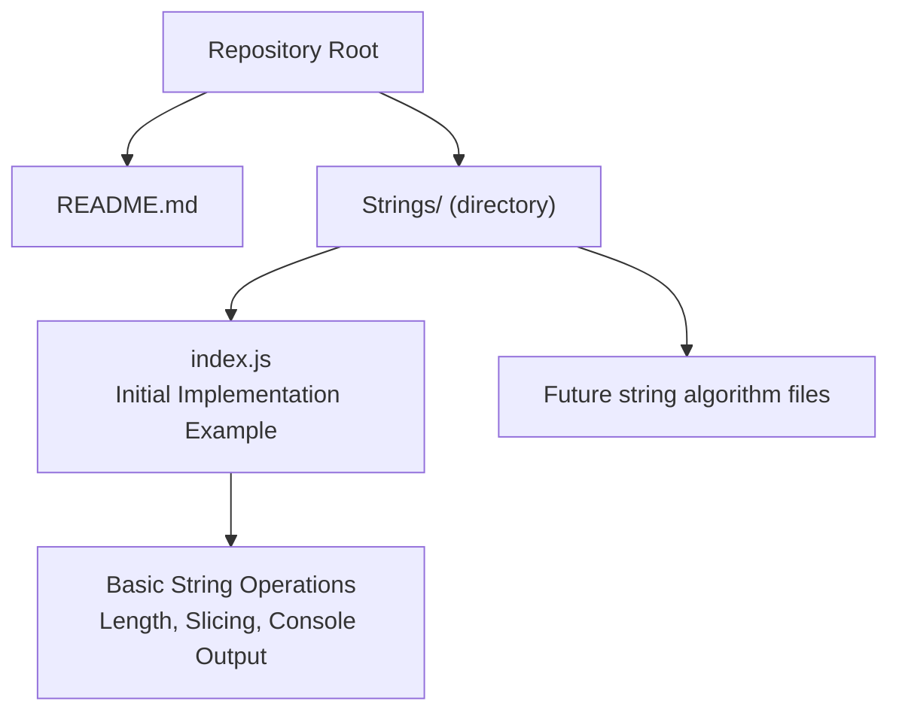
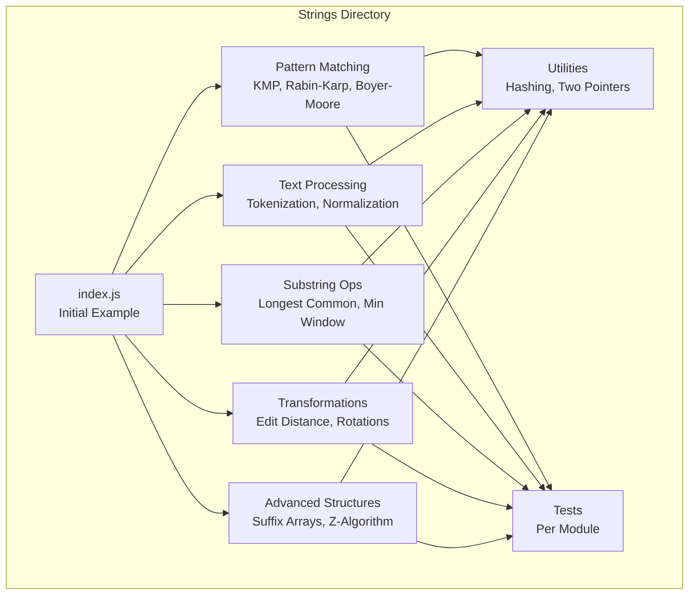
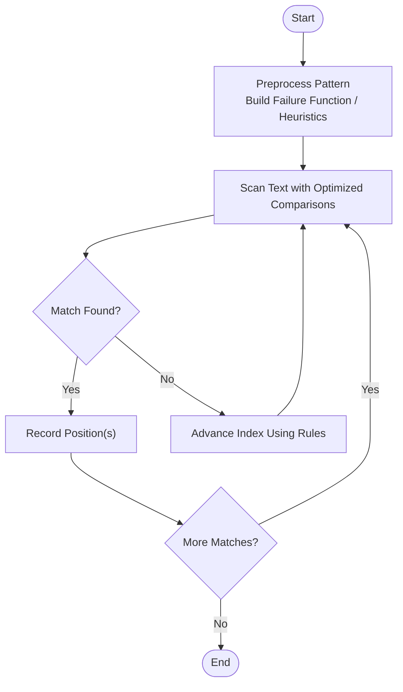
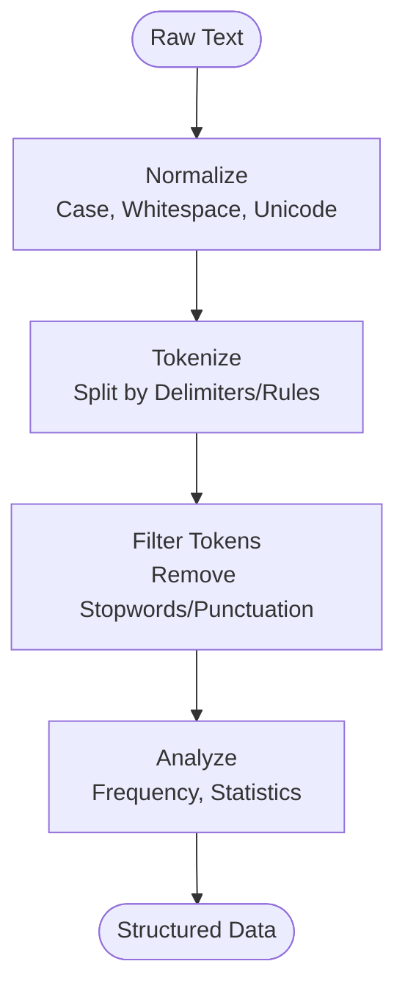
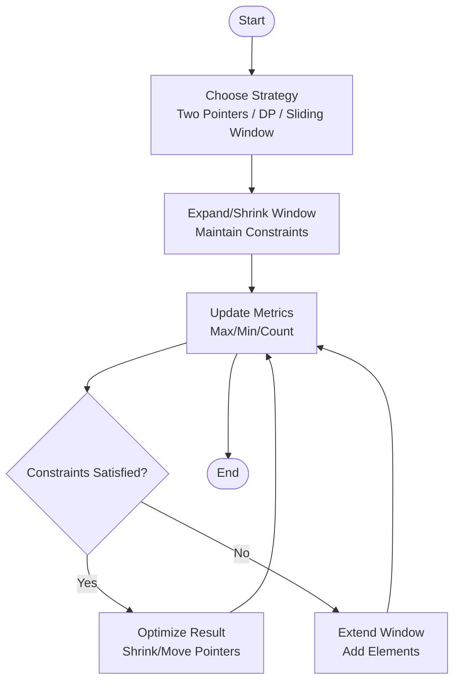
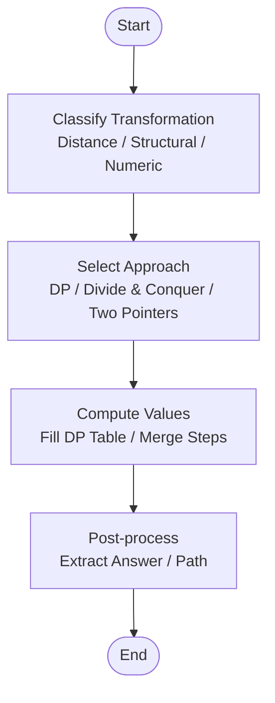
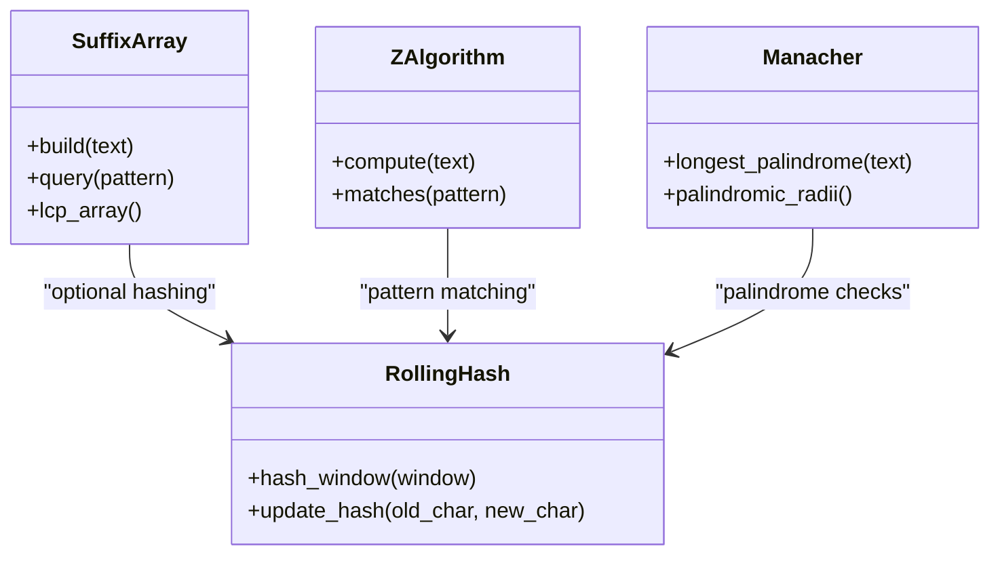
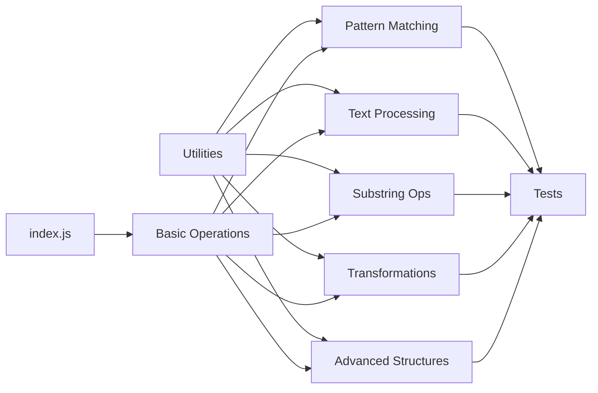

# String Algorithms

<cite>
**Referenced Files in This Document**
- [README.md](file://README.md)
- [Strings/index.js](file://Strings/index.js)
</cite>

## Update Summary
**Changes Made**
- Updated Project Structure section to reflect the addition of Strings/index.js
- Added reference to the initial JavaScript implementation example
- Enhanced implementation guidelines with JavaScript-specific considerations
- Updated diagrams to include the actual file structure

## Table of Contents
1. [Introduction](#introduction)
2. [Project Structure](#project-structure)
3. [Core Components](#core-components)
4. [Architecture Overview](#architecture-overview)
5. [Detailed Component Analysis](#detailed-component-analysis)
6. [Dependency Analysis](#dependency-analysis)
7. [Performance Considerations](#performance-considerations)
8. [Troubleshooting Guide](#troubleshooting-guide)
9. [Conclusion](#conclusion)
10. [Appendices](#appendices)

## Introduction
This document provides a comprehensive guide to string algorithms, focusing on their purpose, importance, and practical application in computer science and software development. It covers common string problems such as pattern matching, text processing, substring operations, and transformations. It also includes implementation guidelines emphasizing efficiency and readability, examples of typical tasks with complexity considerations, and the organizational structure within the Strings directory along with contribution guidelines for new implementations.

String manipulation is foundational across many domains: compilers, search engines, bioinformatics, data cleaning, natural language processing, and competitive programming. Efficient string algorithms can dramatically reduce runtime and memory usage while improving correctness and maintainability.

## Project Structure
The repository contains a dedicated Strings directory housing string algorithm implementations. The directory now includes an initial JavaScript implementation example demonstrating fundamental string operations, serving as a foundation for future contributions.

**Diagram sources**
- [README.md:1-2](file://README.md#L1-L2)
- [Strings/index.js:1-4](file://Strings/index.js#L1-L4)

**Section sources**
- [README.md:1-2](file://README.md#L1-L2)
- [Strings/index.js:1-4](file://Strings/index.js#L1-L4)

## Core Components
This section outlines the core categories of string algorithms that should be implemented and documented within the Strings directory. Each category includes representative problems, typical approaches, and complexity expectations.

- Pattern Matching
  - Naive search: O(n·m) time, O(1) extra space
  - Knuth–Morris–Pratt (KMP): O(n + m) time, O(m) preprocessing
  - Rabin–Karp: average O(n + m), worst-case O(n·m); uses rolling hash
  - Boyer–Moore: sublinear best-case; depends on alphabet and heuristics
  - Aho–Corasick: multi-pattern matching; linear in total input plus output size

- Text Processing
  - Tokenization and parsing
  - Normalization (case folding, Unicode normalization)
  - Compression basics (run-length encoding)
  - Sliding window techniques for substring constraints

- Substring Operations
  - Longest common substring/subsequence
  - Palindromic substrings and palindromic trees
  - Minimum window substring
  - Counting occurrences with frequency maps or suffix structures

- String Transformations
  - Edit distance (Levenshtein)
  - Transposition and inversion counts
  - Reversal and rotation strategies
  - In-place transformations with two-pointer techniques

- Advanced Structures
  - Suffix arrays and suffix trees
  - Z-algorithm
  - Manacher's algorithm for longest palindromic substring
  - Hashing-based methods (rolling hashes, polynomial hashing)

Implementation guidelines:
- Prefer clarity first, then optimize; profile before micro-optimizing.
- Use well-known algorithms where applicable; avoid reinventing wheels.
- Validate inputs and handle edge cases (empty strings, single characters).
- Separate preprocessing from query logic when possible.
- Provide unit tests covering boundary conditions and large inputs.
- Document time and space complexity explicitly in comments or docstrings.
- For JavaScript implementations, leverage built-in string methods and consider performance implications of string immutability.

[No sources needed since this section provides general guidance]

## Architecture Overview
A recommended architecture for the Strings directory organizes algorithms by problem family and separates concerns into reusable modules:

- Algorithm Modules: One file per algorithm or closely related set of algorithms.
- Utilities: Shared helpers for hashing, sliding windows, two pointers, and I/O.
- Tests: Unit tests per algorithm module.
- Documentation: README or inline comments explaining approach, complexity, and usage.

[No sources needed since this diagram shows conceptual workflow, not actual code structure]

## Detailed Component Analysis
Below are detailed analyses for each major component area, including typical workflows, design patterns, and complexity trade-offs.

### Pattern Matching
Purpose: Find occurrences of a pattern P in a text T efficiently.

Common approaches:
- KMP: Preprocess pattern to build failure function; scan text in one pass.
- Rabin–Karp: Rolling hash enables fast equality checks; good for multiple patterns.
- Boyer–Moore: Uses mismatch and good-suffix rules to skip characters.

Complexity highlights:
- KMP: O(n + m) time, O(m) space
- Rabin–Karp: Average O(n + m), worst O(n·m)
- Boyer–Moore: Best-case sublinear; depends on alphabet and precomputation

Implementation tips:
- Handle overlapping matches if required.
- Choose algorithm based on expected pattern length and alphabet size.
- For multiple patterns, consider Aho–Corasick.

[No sources needed since this section provides general guidance]

### Text Processing
Purpose: Clean, normalize, and extract structured information from raw text.

Key tasks:
- Tokenization: Split text into words/tokens using delimiters or regex-like rules.
- Normalization: Case-folding, whitespace collapsing, Unicode normalization.
- Run-Length Encoding: Compact repeated sequences for storage/transmission.

Complexity highlights:
- Linear-time passes over text dominate; tokenization typically O(n).
- Filtering and analysis depend on downstream structures (e.g., hash maps O(1) avg).

Implementation tips:
- Stream processing for large texts to minimize memory.
- Avoid excessive allocations; reuse buffers where appropriate.

[No sources needed since this section provides general guidance]

### Substring Operations
Purpose: Compute properties or relationships between substrings efficiently.

Representative problems:
- Longest Common Substring/Subsequence
- Minimum Window Substring
- Counting distinct substrings
- Palindromic substrings and expansions

Complexity highlights:
- Sliding window often O(n) with constant-size alphabets.
- DP-based solutions may be O(n^2) time/space; optimize with rolling arrays if possible.

Implementation tips:
- Clearly define window invariants.
- Track frequencies with arrays or hash maps depending on alphabet size.

[No sources needed since this section provides general guidance]

### String Transformations
Purpose: Modify strings to achieve desired forms or compute distances.

Representative problems:
- Edit Distance (Levenshtein)
- Reverse, Rotate, Anagram Checks
- Inversion Count via Merge Sort

Complexity highlights:
- Edit Distance: O(n·m) time and space; can reduce space to O(min(n, m)).
- Inversion Count: O(n log n) via merge sort.

Implementation tips:
- Use iterative DP with rolling rows to save space.
- Validate transformation invariants (length, character sets).

[No sources needed since this section provides general guidance]

### Advanced Structures
Purpose: Support complex queries and global string properties.

Representative topics:
- Suffix Arrays and LCP Arrays
- Z-Algorithm for prefix-function-like computations
- Manacher's Algorithm for palindromes
- Hashing Techniques (rolling/polynomial)

Complexity highlights:
- Suffix array construction: O(n log n) or O(n) depending on algorithm.
- Z-array: O(n) time.
- Manacher: O(n) time.

Implementation tips:
- Prefer stable sorting and careful index management.
- Combine with binary search for efficient range queries.

[No sources needed since this diagram shows conceptual workflow, not actual code structure]

## Dependency Analysis
The Strings directory now contains an initial implementation example that demonstrates basic string operations. When adding new algorithms, follow these dependency principles:

- Cohesion: Group related algorithms in the same module.
- Coupling: Keep utilities minimal and focused; avoid circular imports.
- Testing: Ensure each module has corresponding tests.
- Documentation: Include complexity and usage notes.

**Diagram sources**
- [Strings/index.js:1-4](file://Strings/index.js#L1-L4)

**Section sources**
- [Strings/index.js:1-4](file://Strings/index.js#L1-L4)

## Performance Considerations
- Time Complexity:
  - Prefer linear-time algorithms (O(n)) for scanning and preprocessing.
  - Use dynamic programming judiciously; compress state when possible.
- Space Complexity:
  - Minimize auxiliary structures; use in-place modifications when safe.
  - Leverage streaming to process large inputs without full materialization.
- Constant Factors:
  - Avoid unnecessary copies; prefer iterators or indices.
  - Use built-in functions and libraries optimized in lower-level languages.
- Benchmarking:
  - Profile hot paths with realistic datasets.
  - Compare naive vs. optimized implementations to validate gains.
- JavaScript-Specific Considerations:
  - Be aware of string immutability and its performance implications.
  - Use typed arrays for numerical operations when possible.
  - Consider WebAssembly for computationally intensive string operations.

[No sources needed since this section provides general guidance]

## Troubleshooting Guide
Common issues and resolutions:
- Off-by-one errors in indices:
  - Verify loop bounds and termination conditions carefully.
- Memory overflows:
  - Monitor intermediate structures; switch to streaming or incremental computation.
- Incorrect complexity assumptions:
  - Re-evaluate nested loops and hidden costs (e.g., string concatenation).
- Edge cases:
  - Empty strings, single-character inputs, all-matching patterns, and non-overlapping requirements.
- Hash collisions:
  - Use robust hashing schemes or fallback to deterministic checks.
- JavaScript-Specific Issues:
  - String method chaining errors and type coercion pitfalls.
  - Memory leaks from improper event listener cleanup in browser environments.

[No sources needed since this section provides general guidance]

## Conclusion
String algorithms are essential tools for building efficient and reliable software systems. With the addition of the initial JavaScript implementation example in Strings/index.js, the repository now provides a concrete starting point for contributors. By organizing implementations thoughtfully within the Strings directory, adhering to best practices for efficiency and readability, and documenting complexity and usage clearly, contributors can create a robust knowledge base. The provided guidelines and diagrams serve as a foundation for expanding the repository with high-quality string algorithm implementations.

[No sources needed since this section summarizes without analyzing specific files]

## Appendices
- Contribution Guidelines:
  - Add a new file under Strings/ named after the algorithm (e.g., kmp_search.js).
  - Include clear docstrings/comments describing approach, inputs, outputs, and complexity.
  - Write unit tests covering normal cases, edge cases, and performance-sensitive scenarios.
  - Follow consistent naming conventions and modular structure as outlined above.
  - Reference the initial example in index.js for basic string operation patterns.

**Section sources**
- [Strings/index.js:1-4](file://Strings/index.js#L1-L4)